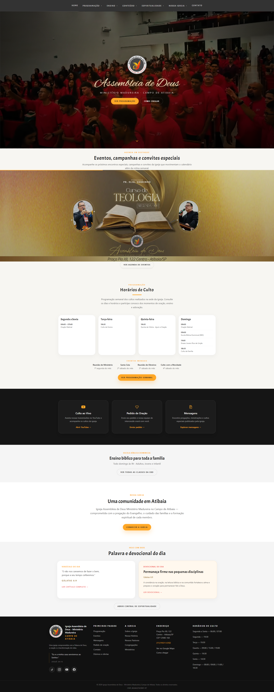
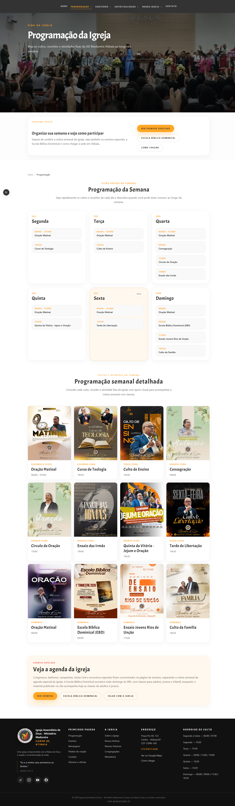
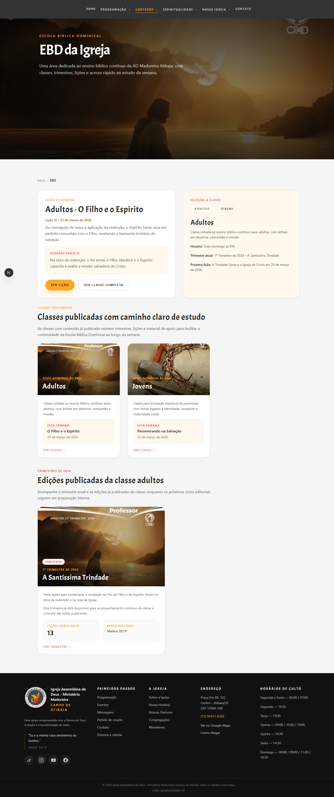
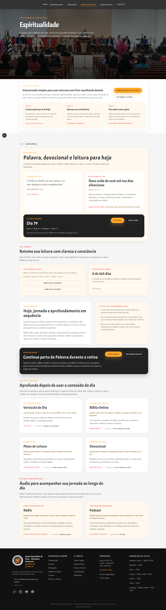
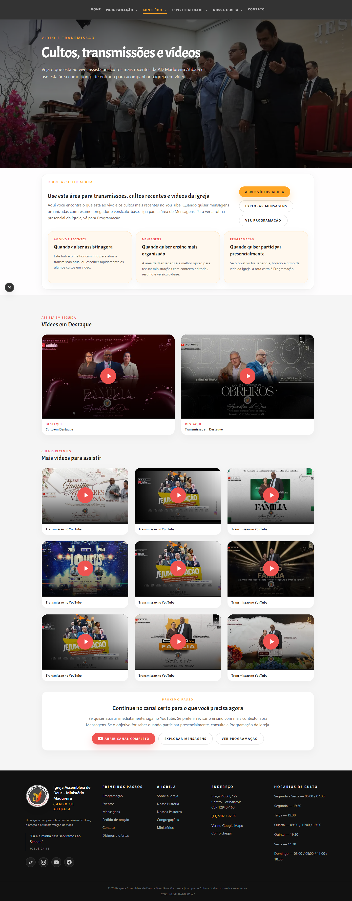

# AD Madureira Atibaia — Digital Church Platform


Website institucional e hub espiritual digital da **Igreja Assembleia de Deus – Ministério Madureira (Campo de Atibaia)**.

Desenvolvido com **Next.js, React, TypeScript e TailwindCSS**, com foco em performance, SEO, organização de conteúdo e experiência mobile-first.

Além da presença institucional, a aplicação funciona como um **hub espiritual digital**, reunindo Bíblia online, devocionais, EBD, agenda, mensagens e canais de contato em um único ponto de acesso.

---

## 🌐 Produção

**[admadureiraatibaia.com.br](https://admadureiraatibaia.com.br)**

## 🏠 Home



---

## 🎯 Problema

Grande parte das igrejas brasileiras concentra sua comunicação exclusivamente em redes sociais, o que gera:

- informações dispersas e de difícil acesso
- programação sem organização centralizada
- ausência de recursos espirituais de fácil consulta
- baixa acessibilidade para visitantes e novos membros

---

## 💡 Solução

Plataforma digital que centraliza:

- programação semanal da igreja
- agenda de eventos especiais
- conteúdos bíblicos e devocionais
- materiais da Escola Bíblica Dominical
- mensagens e estudos
- histórico e identidade institucional
- canais diretos de contato, oração e localização

---

## ✨ Funcionalidades

### 📅 Programação Semanal
Exibição estruturada da rotina da igreja: cultos, oração matinal, EBD, campanhas e reuniões ministeriais.

### 📆 Agenda de Eventos
Sistema separado da programação fixa para eventos especiais: congressos, cultos especiais, campanhas temáticas e eventos do campo de Atibaia.

### 📖 Hub de Espiritualidade
Área dedicada ao crescimento espiritual diário: Bíblia online, versículo do dia, devocionais, plano de leitura e rádio cristã.

### 🎓 Escola Bíblica Dominical (EBD)
Lições semanais, resumos, materiais de apoio e versão para impressão — para adultos, jovens e infantil.

### 🎥 Mensagens
Biblioteca de conteúdos espirituais: vídeos, reflexões e estudos bíblicos.

### 🤝 Ministérios
Apresentação dos ministérios da igreja com informações e formas de contato.

### 🙏 Pedidos de Oração e Contato
Canal direto entre membros, visitantes e a liderança da igreja.

---

## 📸 Preview

### Programação


### EBD


### Espiritualidade


### Conteúdo e vídeos


---

## 🧠 Arquitetura

```text
src/
  app/          rotas e páginas (Next.js App Router); /keystatic é o painel de conteúdo
  components/   componentes reutilizáveis de UI
  sections/     blocos estruturais de páginas
  data/         conteúdo e dados institucionais (TypeScript validado com Zod)
  lib/          utilitários, helpers e regras de negócio
  hooks/        hooks personalizados
public/programacao/semanas/AAAA-MM-DD/   artes semanais da programação
scripts/        manifesto de banners, compressão de artes, smoke test, gate editorial da EBD (Python)
docs/           arquitetura, decisões, runbook, governança da EBD e baselines de performance
```

Não há banco de dados nem backend próprio. O conteúdo vive no repositório, as páginas são geradas no build e revalidadas por tempo (ISR). Fontes externas: YouTube Data API/RSS (mensagens, testemunhos, live) e bible-api.com (Bíblia). Ver [docs/architecture.md](docs/architecture.md).

---

## ⚙️ Stack

| Camada | Tecnologia |
|---|---|
| Framework | Next.js 16 (App Router) |
| UI | React 19 + Tailwind CSS 4 |
| Linguagem | TypeScript (strict) + Zod 4 |
| Testes | Vitest |
| Painel de conteúdo | Keystatic (artes da semana) |
| Deploy | Vercel, Node 24, funções em São Paulo (`gru1`) |
| Métricas | Vercel Speed Insights |
| Integração de mídia | YouTube Data API + RSS |

---

## 🧪 Scripts

| Comando | O que faz |
|---|---|
| `npm run dev` | Servidor de desenvolvimento (gera o manifesto de banners antes) |
| `npm run build` | Build de produção |
| `npm run lint` | ESLint |
| `npm run test:run` | Testes (Vitest) |
| `npm run smoke -- <url>` | Smoke test das rotas principais contra um servidor rodando |
| `npm run optimize:artes -- <pasta>` | Comprime PNGs das artes sem mudar nome nem formato |
| `npm run audit:assets` | Audita os assets de `public/` |

## ✅ Qualidade e segurança

- **CI (GitHub Actions)** em todo PR: `npm audit --audit-level=high`, ESLint, `tsc --noEmit`, testes, build, smoke test e varredura de segredos (gitleaks).
- **Branch `main` protegida**: merge só com o check `CI` verde, sem force push. Merges sempre por squash.
- **Dependabot** semanal, com patch e minor agrupados num PR só; majors vêm em PR próprio.
- **Cabeçalhos de segurança** em `next.config.ts`: CSP, `X-Content-Type-Options`, `Referrer-Policy`, `Permissions-Policy`, `X-Frame-Options`.

---

## 🛠️ Rodando localmente

```bash
# Clone o repositório
git clone https://github.com/JrValerio/admadureira-atibaia

# Entre no diretório
cd admadureira-atibaia

# Instale as dependências
npm install

# Crie o arquivo de variáveis de ambiente
cp .env.example .env.local

# Execute em modo de desenvolvimento
npm run dev
```

Acesse `http://localhost:3000`.

---

## 🔒 Variáveis de ambiente

| Variável | Descrição |
|---|---|
| `NEXT_PUBLIC_SITE_URL` | URL canônica do site em produção |
| `YOUTUBE_API_KEY` | Chave da YouTube Data API |
| `YOUTUBE_CHANNEL_ID` | ID do canal no YouTube (opcional se o canal padrão for usado) |
| `YOUTUBE_CHANNEL_HANDLE` | Handle do canal (ex: `@ADMadureiraAtibaia`) |
| `YOUTUBE_MESSAGES_PLAYLIST_ID` | Playlist oficial de Mensagens (opcional; há valor padrão no projeto) |
| `YOUTUBE_TESTIMONIALS_PLAYLIST_ID` | Playlist oficial de Testemunhos (opcional; há valor padrão no projeto) |
| `KEYSTATIC_GITHUB_CLIENT_ID` | GitHub App do painel. Sem ele, o painel só funciona em `npm run dev` |
| `KEYSTATIC_GITHUB_CLIENT_SECRET` | Segredo do GitHub App do painel |
| `KEYSTATIC_SECRET` | Segredo de sessão do painel |
| `NEXT_PUBLIC_KEYSTATIC_GITHUB_APP_SLUG` | Slug do GitHub App do painel |

Na Vercel, marque as chaves e segredos como **Sensitive**.

---

## 🖼️ Artes da semana

Toda segunda-feira, as artes da programação vão para `public/programacao/semanas/AAAA-MM-DD/` (data da segunda), com os nomes de `src/lib/banner-semanal.ts`. Há dois caminhos:

- **Painel** (`/keystatic` → Artes da semana): sobe cada arte no campo do culto e publica. Cada publicação vira um commit. Em produção, exige o GitHub App configurado.
- **Manual**: copiar os PNGs, rodar `npm run optimize:artes -- public/programacao/semanas/AAAA-MM-DD` e abrir PR. Passo a passo em [docs/runbook.md](docs/runbook.md).

---

## 📚 EBD — Escopo editorial

O projeto mantém estrutura editorial por trimestre e classe, com conteúdo publicado de forma progressiva conforme governança interna.

Estado atual (novembro/2026):

- **Adultos** — 1T, 2T, 3T e 4T/2026 publicados
- **Jovens** — 1T, 2T, 3T e 4T/2026 publicados
- **Infantil** — arquitetura mantida; publicação editorial pausada aguardando material da coordenação

A publicação no front segue critérios de revisão, disponibilidade de material de apoio e decisão editorial do projeto.

Ver [docs/ebd-governance.md](docs/ebd-governance.md) para regras de publicação, rascunho e governança.

---

## 🧭 Roadmap

Ver [docs/roadmap.md](docs/roadmap.md) para o planejamento de evoluções.

---

## 📍 Igreja

**Assembleia de Deus – Ministério Madureira**
Praça Pio XII, 122 – Centro – Atibaia/SP

[Instagram](https://www.instagram.com/admadureira_atibaia/) · [YouTube](https://www.youtube.com/@ADMadureiraAtibaia)

---

## 📄 Licença

Uso institucional da igreja. Avalie a política de conteúdo e direitos antes de redistribuir textos, imagens, materiais editoriais ou conteúdos de terceiros.
