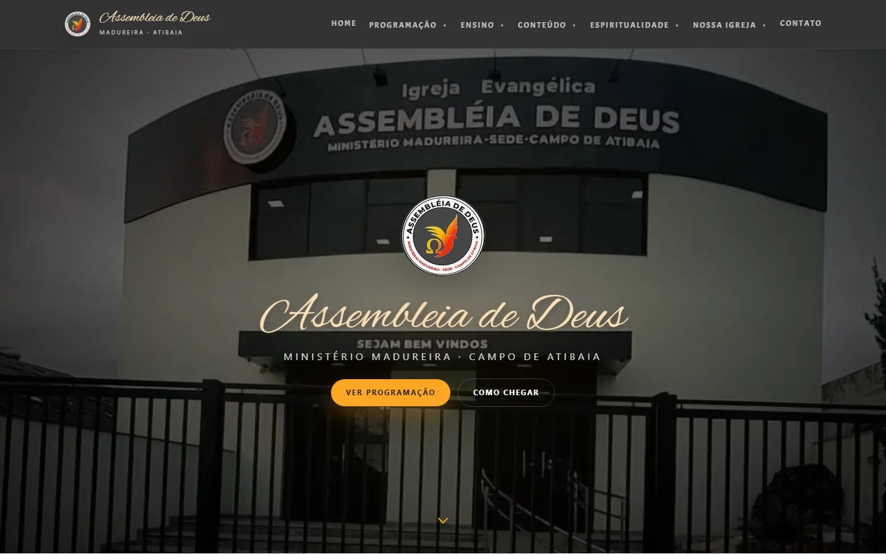
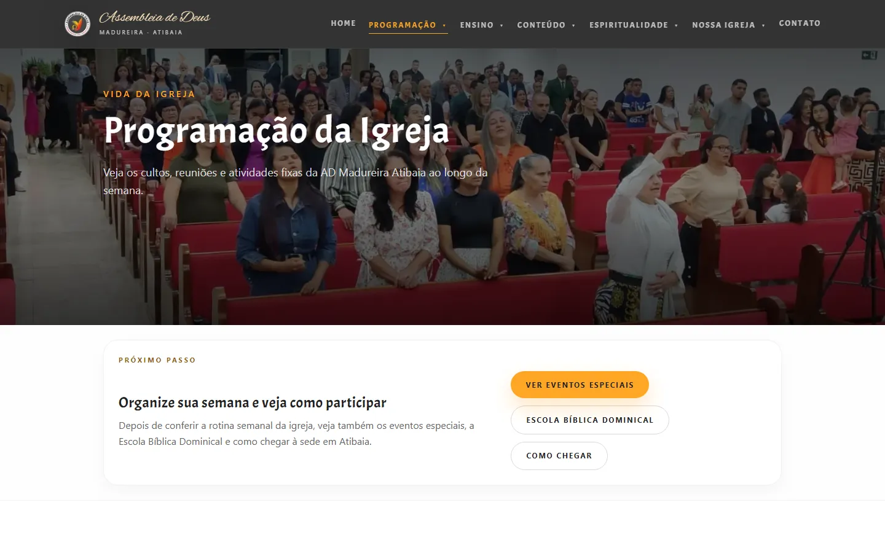
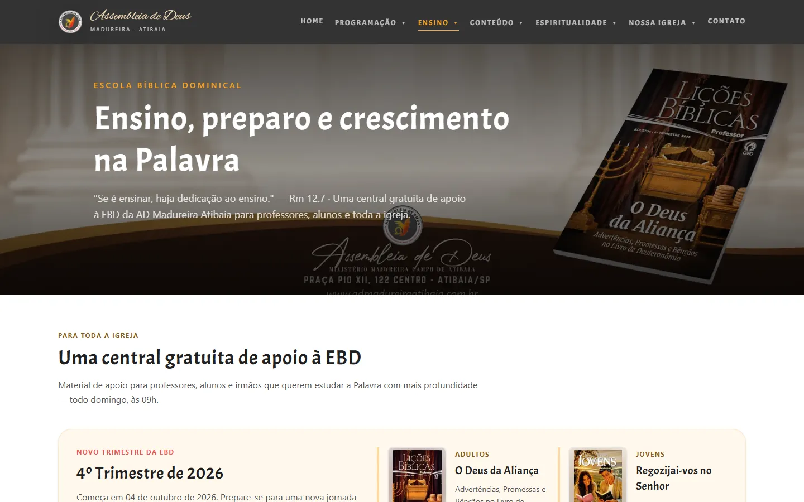
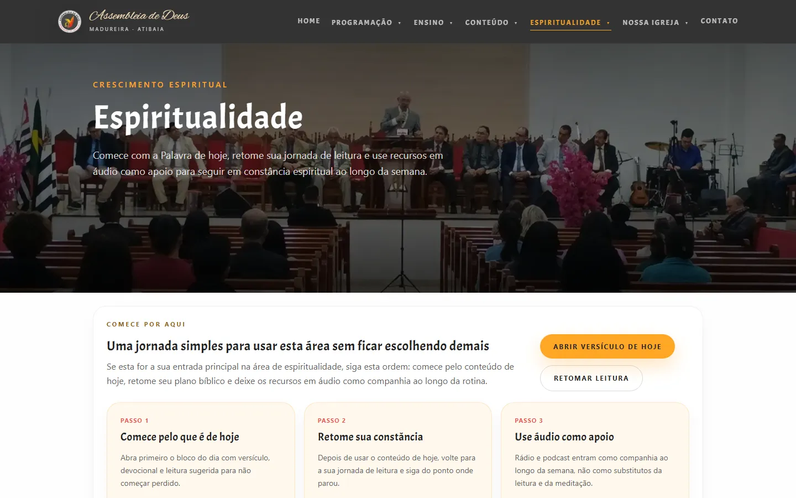
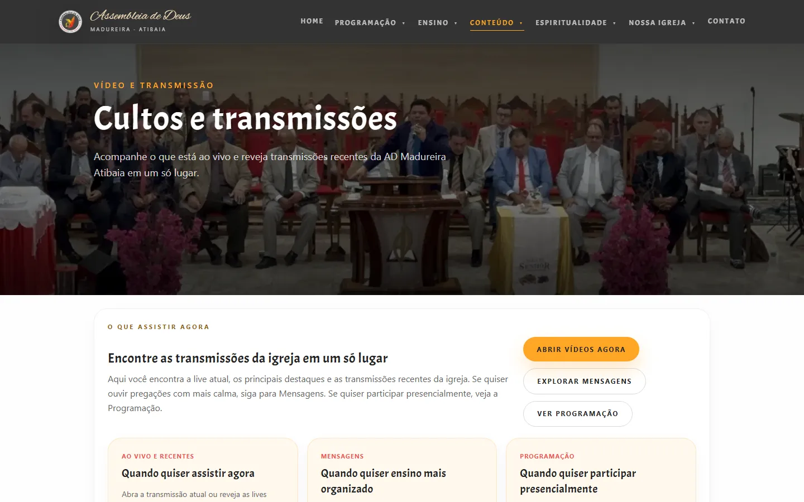
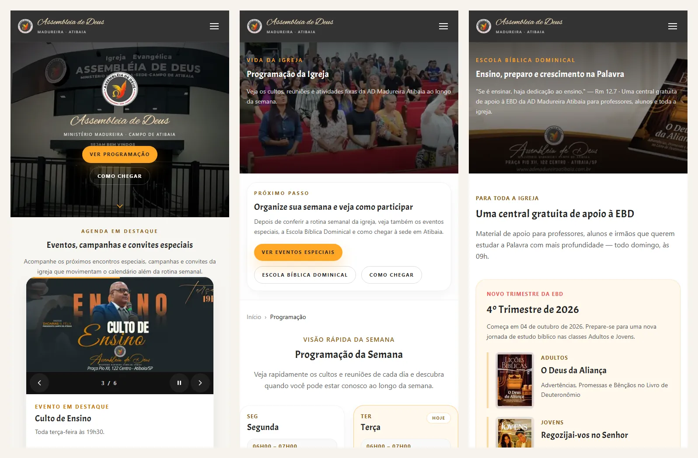

# AD Madureira Atibaia

Site institucional e hub espiritual da **Assembleia de Deus – Ministério Madureira, Campo de Atibaia**: programação da semana, eventos, Escola Bíblica Dominical, Bíblia online, devocionais, mensagens e contato, num só lugar e pensado primeiro para o celular.

**Produção:** [admadureiraatibaia.com.br](https://www.admadureiraatibaia.com.br)



## O que o site oferece

| Área | Conteúdo |
|---|---|
| Programação | Rotina semanal de cultos e reuniões, com a arte da semana de cada culto e exceções por data |
| Eventos | Congressos, cultos especiais e campanhas, com página própria, contagem regressiva e destaque na home |
| EBD | Lições de Adultos e Jovens por trimestre, subsídios para o professor e versão para impressão |
| Espiritualidade | Bíblia online, versículo do dia, devocionais e planos de leitura |
| Mensagens e vídeos | Pregações, testemunhos e a transmissão ao vivo, puxados do canal do YouTube |
| Igreja | História, pastores, ministérios, congregações do campo, oferta via Pix e contato pelo WhatsApp |

## Telas

| Programação | EBD |
|---|---|
|  |  |
| **Espiritualidade** | **Cultos e transmissões** |
|  |  |

No celular (home, programação e EBD):



## Stack

| Camada | Tecnologia |
|---|---|
| Framework | Next.js 16 (App Router) |
| UI | React 19 + Tailwind CSS 4 |
| Linguagem | TypeScript (strict) + Zod 4 |
| Testes | Vitest |
| Painel de conteúdo | Keystatic (artes da semana) |
| Hospedagem | Vercel, Node 24, funções em São Paulo (`gru1`) |
| Métricas | Vercel Speed Insights |
| Mídia | YouTube Data API + RSS |

## Arquitetura

```text
src/
  app/          rotas e páginas (App Router); /keystatic é o painel de conteúdo
  components/   componentes de UI
  sections/     blocos de página
  data/         conteúdo e dados institucionais (TypeScript validado com Zod)
  lib/          regras de negócio e utilitários
  hooks/        hooks
public/programacao/semanas/AAAA-MM-DD/   artes semanais da programação
scripts/        manifesto de banners, compressão de artes, smoke test, gate editorial da EBD (Python)
docs/           arquitetura, decisões, runbook, governança da EBD, performance
```

Não há banco de dados nem backend próprio. O conteúdo vive no repositório, as páginas são geradas no build e revalidadas por tempo (ISR). Fontes externas: YouTube (mensagens, testemunhos e live) e bible-api.com (Bíblia). Detalhes em [docs/architecture.md](docs/architecture.md).

## Rodando localmente

```bash
git clone https://github.com/JrValerio/admadureira-atibaia
cd admadureira-atibaia
npm install
cp .env.example .env.local
npm run dev
```

Abra `http://localhost:3000`.

| Comando | O que faz |
|---|---|
| `npm run dev` | Servidor de desenvolvimento (gera antes o manifesto de banners) |
| `npm run build` | Build de produção |
| `npm run lint` | ESLint |
| `npm run test:run` | Testes |
| `npm run smoke -- <url>` | Smoke test das rotas principais |
| `npm run optimize:artes -- <pasta>` | Comprime as artes PNG sem mudar nome nem formato |
| `npm run audit:assets` | Audita os assets de `public/` |

## Variáveis de ambiente

| Variável | Uso |
|---|---|
| `NEXT_PUBLIC_SITE_URL` | URL canônica em produção |
| `YOUTUBE_API_KEY` | Chave da YouTube Data API |
| `YOUTUBE_CHANNEL_ID` | Canal do YouTube (opcional; há padrão no projeto) |
| `YOUTUBE_CHANNEL_HANDLE` | Handle do canal, ex.: `@ADMadureiraAtibaia` |
| `YOUTUBE_MESSAGES_PLAYLIST_ID` | Playlist de Mensagens (opcional) |
| `YOUTUBE_TESTIMONIALS_PLAYLIST_ID` | Playlist de Testemunhos (opcional) |
| `KEYSTATIC_GITHUB_CLIENT_ID` | GitHub App do painel; sem ele, o painel só funciona em `npm run dev` |
| `KEYSTATIC_GITHUB_CLIENT_SECRET` | Segredo do GitHub App do painel |
| `KEYSTATIC_SECRET` | Segredo de sessão do painel |
| `NEXT_PUBLIC_KEYSTATIC_GITHUB_APP_SLUG` | Slug do GitHub App do painel |

Na Vercel, marque chaves e segredos como **Sensitive**.

## Artes da semana

Toda segunda-feira, as artes da programação vão para `public/programacao/semanas/AAAA-MM-DD/` (data da segunda), com os nomes de `src/lib/banner-semanal.ts`. Há dois caminhos:

- **Painel:** `/keystatic` → Artes da semana. Cada publicação vira um commit. Em produção, exige o GitHub App configurado.
- **Manual:** copiar os PNGs, rodar `npm run optimize:artes -- public/programacao/semanas/AAAA-MM-DD` e abrir PR. Passo a passo em [docs/runbook.md](docs/runbook.md).

## EBD

Conteúdo organizado por classe e trimestre, publicado aos poucos conforme a governança editorial. Lições em rascunho existem por rota direta, com `noindex`, e ficam fora do sitemap.

Novembro/2026: Adultos e Jovens com 1º a 4º trimestres de 2026 publicados. Infantil com estrutura pronta e publicação pausada, aguardando material da coordenação. Regras em [docs/ebd-governance.md](docs/ebd-governance.md).

## Qualidade e segurança

- **CI** em todo PR: `npm audit`, ESLint, `tsc --noEmit`, testes, build, smoke test e varredura de segredos (gitleaks).
- **`main` protegida:** merge só com CI verde e por squash, sem force push. A branch é apagada após o merge.
- **Dependabot** semanal, com patch e minor agrupados; majors em PR próprio.
- **Cabeçalhos** em `next.config.ts`: CSP, `X-Content-Type-Options`, `Referrer-Policy`, `Permissions-Policy` e `X-Frame-Options`.
- Mudanças por versão em [CHANGELOG.md](CHANGELOG.md); planos em [docs/roadmap.md](docs/roadmap.md).

## A igreja

**Assembleia de Deus – Ministério Madureira**
Praça Pio XII, 122 – Centro – Atibaia/SP
[Instagram](https://www.instagram.com/admadureira_atibaia/) · [YouTube](https://www.youtube.com/@ADMadureiraAtibaia)

## Licença

Uso institucional da igreja. Textos, imagens, materiais editoriais e conteúdos de terceiros têm direitos próprios; avalie antes de redistribuir.
